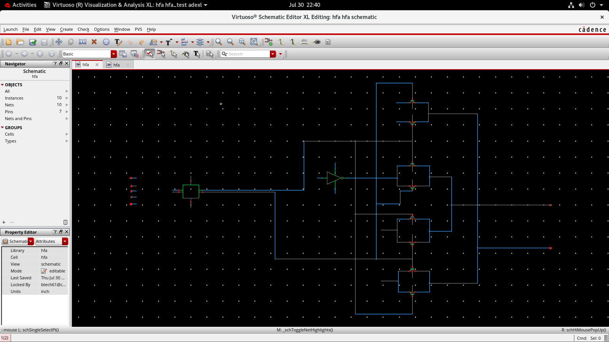

# Power-Optimized Hybrid Full Adder Using Dual-Vt

This is our capstone project at VIT-AP. We took a 22-transistor hybrid full adder (HFA), built it in Cadence Virtuoso, and tried to lower its power by using two different threshold voltages (Dual-Vt) inside the same circuit.

**Where the project stands right now:** the baseline and the Dual-Vt versions both work functionally, and average power has been simulated for both. Delay and PDP have not been measured yet, so we can't say yet whether Dual-Vt is a good trade-off overall.

---

## Why this project

A full adder sits inside almost every arithmetic circuit, such as adders, multipliers and ALUs. Even a small saving in one cell adds up when thousands of them are used.

A hybrid full adder mixes logic styles (XOR/XNOR blocks with transmission-gate multiplexing) to keep the transistor count low. At small technology nodes, leakage current is a big part of total power, so reducing it matters.

Dual-Vt is one way to do that. Transistors with a high threshold voltage leak less but switch slower. Transistors with a lower threshold voltage are faster but leak more. The idea is to use high-Vt where speed doesn't matter much and keep faster devices on the critical path. This does not always work out, so it has to be checked by simulation. That is what this project does.

## What we wanted to do

1. Build a baseline 22T hybrid full adder and check that Sum and Cout are correct.
2. Apply Dual-Vt to it and check that the logic still works.
3. Compare both designs on average power, propagation delay and PDP, using the same testbench.

## Design details

| Item | Value |
|---|---|
| Circuit | Hybrid full adder, 22 transistors |
| Inputs / outputs | A, B, Cin / Sum, Cout |
| Supply voltage | 1 V |
| Temperature | 27 °C |
| Input rise time | 10 ps |
| Technology | FinFET |

**Tools:** Cadence Virtuoso (Schematic Editor XL, ADE with Spectre, and the Visualization & Analysis XL waveform viewer and calculator).

## How the Dual-Vt version was made

1. Simulate the baseline, where all transistors use the same Vt, and note its power.
2. Look at the circuit and decide which transistors are on the critical path (the slowest route from input to output).
3. Put high-Vt devices on the non-critical transistors to cut leakage, and keep the faster devices on the critical path.
4. Run the same simulation again and compare.

*A transistor-by-transistor table of the Vt choices will go here.*

## Building and checking the circuit

We built the design from the bottom up. The small blocks were made and tested first, then combined into the full adder.

| Block | Schematic | Symbol | Testbench | Waveform |
|---|---|---|---|---|
| Inverter | ✔ | ✔ | ✔ | ✔ |
| Buffer | ✔ | ✔ | ✔ | ✔ |
| XOR/XNOR | ✔ | ✔ | ✔ | ✔ |
| HFA 22T (baseline) | ✔ | ✔ | ✔ | ✔ |
| HFA 22T (Dual-Vt) | ✔ | ✔ | ✔ | ✔ |

For the full adder, the testbench drives A, B and Cin with pulse sources so that all eight input combinations appear in one 200 ns run. A changes every 25 ns, B every 50 ns, and Cin at 100 ns. We checked Sum and Cout against the truth table in the waveform.




## How power, delay and PDP are measured

**Average power.** This is the average of the instantaneous supply power over the whole transient run. In the Virtuoso calculator we used `average(getData("I0:pwr" ?result "tran"))`.

P_avg = (1/T) ∫ VDD · i_DD(t) dt

**Propagation delay.** This is the time from the input crossing 50 % of VDD to the output crossing 50 % of VDD. Measure it for the rising and falling output edges and take the average.

t_pd = (t_PLH + t_PHL) / 2

**PDP.** Power multiplied by delay, which gives energy per operation.

PDP = P_avg × t_pd

**Percentage improvement.** Always taken with the baseline as the reference:

Improvement (%) = (Baseline − Dual-Vt) / Baseline × 100

A positive number means the Dual-Vt design is lower than the baseline.

## Results

| Design | Threshold-voltage configuration | Average power | Propagation delay | PDP | Simulation status |
|---|---|---|---|---|---|
| Baseline HFA 22T | Single Vt *(confirm type)* | 492 nW | To be measured | To be calculated | Power done, delay pending |
| Dual-Vt HFA 22T | Mixed Vt *(to be added)* | 387.5 nW | To be measured | To be calculated | Power done, delay pending |

Average power dropped from 492 nW to 387.5 nW, which is about 21.2 % lower. This is only the power side. Until delay is measured, we can't tell whether PDP also improved.

A few other numbers from the simulations:

| Measurement | Baseline | Dual-Vt |
|---|---|---|
| DC supply current at Vin = 0 V | 415.616 nA | 281.851 nA |
| DC supply current at Vin = 1.0 V | 15.4773 nA | 15.4576 nA |
| Average transient current, `i("I0:7")` | 214.2 nA | 180.3 nA |

The screenshots for these are in `simulation/hfa_22t_baseline/` and `simulation/hfa_22t_dual_vt/`.

## Limitations

- Delay and PDP are still missing, so the power saving is not yet weighed against speed.
- Everything was run at one supply voltage, one temperature and one input pattern. We haven't checked process corners or Monte Carlo variation.
- All results are from the schematic, so layout parasitics are not included.
- The load capacitance and the exact Vt assignment still need to be written down.

## What comes next

- Measure t_PLH, t_PHL and t_pd, then work out PDP for both designs.
- Repeat at different supply voltages and temperatures, and across corners.
- Run Monte Carlo to see the effect of variation.
- Draw the layout, run DRC and LVS, and simulate again with extracted parasitics.
- Compare with other published full adders.

## Repository layout

```
hybrid-full-adder-dual-vt/
├── README.md
├── .gitignore
├── docs/          proposal, presentation, report
├── schematics/    inverter, buffer, xor_xnor, hfa_22t
├── simulation/    hfa_22t_baseline, hfa_22t_dual_vt
└── results/       comparison tables and calculations
```

## References

*To be added from our literature review. Only papers we actually used will be listed.*

## Team and acknowledgements

*Team member names, faculty guide and acknowledgements to be added.*
